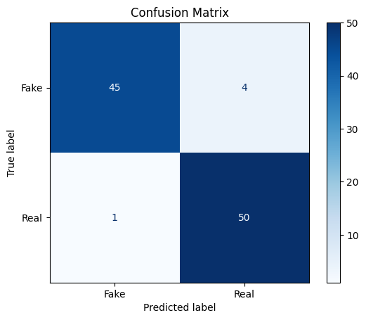

# Fake News Detection with DistilBERT

**Fine-tuning a distilled transformer to tell fake from real political news articles.**

Project for the NLP division of *Women in STEM and Economics (WISE)*, Bocconi University (2025).

<p align="center">
  
</p>

## Approach

- **Data.** The *Fake or Real News* corpus (6,335 articles, balanced between the two classes). To keep fine-tuning fast on a laptop GPU, a random subset of 1,000 articles is used, split into stratified training (810), validation (90) and test (100) sets.
- **Cleaning.** Removal of HTML tags, URLs and agency boilerplate (e.g. "Reuters –"), normalisation of repeated characters and punctuation, lower-casing.
- **Model.** `distilbert-base-uncased` with a single-logit classification head, fine-tuned end to end (Hugging Face Transformers, TensorFlow/Keras): binary cross-entropy on logits, Adam with learning rate 2e-5, inputs truncated to 256 tokens, batch size 4, balanced class weights, early stopping on validation loss (best weights restored).

## Results

On the 100 held-out test articles:

| Class | Precision | Recall | F1 |
|---|---:|---:|---:|
| Fake | 0.98 | 0.92 | 0.95 |
| Real | 0.93 | 0.98 | 0.95 |
| **Accuracy** | | | **0.95** |

The model peaks after three epochs (validation accuracy 0.96) and early stopping halts training two epochs later. With only 100 test articles, each misclassification moves accuracy by a full point, so these figures carry a few points of uncertainty.

*Note on the metrics printed during training.* The Keras accuracy, precision and recall in the training log apply a 0.5 threshold directly to the logit rather than to the probability, so they differ slightly from the table above, which uses the correct decision rule (logit > 0).

## Repository structure

```
.
├── fake_news_distilbert.ipynb   Data cleaning, fine-tuning, evaluation and example predictions
├── requirements.txt
└── assets/                      Figures used in this README
```

## Running the notebook

Download `fake_or_real_news.csv` (the *Fake or Real News* dataset, available on Kaggle) into a `data/` folder next to the notebook, then:

```bash
pip install -r requirements.txt
jupyter notebook fake_news_distilbert.ipynb
```

The notebook was run with TensorFlow on Apple Silicon (`tensorflow-metal`); on other platforms, replace `tensorflow.keras.optimizers.legacy.Adam` with `tensorflow.keras.optimizers.Adam`.

